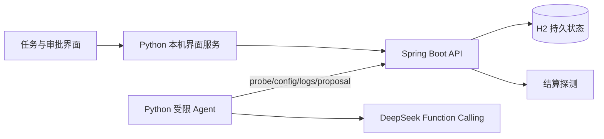

# Config Doctor · 结算故障诊断 Agent

不是又一个 RAG 问答 demo：这里没有向量库和检索，核心问题是一个**要真跑工具、可被强杀恢复、输出可被审计的 Agent 运行时**。Agent 对自建 Java 结算服务做证据诊断，人在字段级补丁上审批，系统按白名单修复并复验。模型只能调用固定 schema 的只读工具并提交带证据的诊断提案，不能批准或执行任何修改。



## Agent 运行时工程（与普通 RAG 项目的差异点）

**模型调用层**
- 指数退避 + 抖动重试，尊重 429 的 `Retry-After`；仅 429/502/503/504 与网络错误可重试，401/畸形响应立即失败。
- 每任务模型调用预算与工具调用预算独立封顶；预算耗尽如实 FAILED，不降级编造。
- 每次调用记录 Token 用量与延迟，运行结束输出汇总（min/median/max）；不折算金额，避免价格表失真。

**上下文管理**
- 上下文超过字符预算时，对较早的工具结果做**确定性压缩**：保留头尾、写入 SHA-256 短哈希与省略量标记；system 与症状消息永不压缩。
- 压缩幂等：已带标记的消息跳过，checkpoint 恢复后重放语义一致。

**控制流守护**
- 连续空转轮次熔断：模型反复不调用工具时提前失败并保留现场，不烧完轮次预算。
- `submit_diagnosis` 必须是唯一调用，防止保存不完整的 tool 消息组；根因与动作映射在提交前校验。
- 畸形 tool_calls（缺 id、arguments 非字符串、未知工具名）转为错误观测回传模型，不中断任务，也不会拼出任意 API 路径。

**执行可恢复**
- 数据库租约 + runToken + checkpoint：每轮先续租再发网络请求，租约过期 token 拒绝写入，新 worker 从 checkpoint 续跑。
- 实测 checkpoint 确认后立即强杀 Java 进程：`WRITE_DELAY=0` 下 6 条消息与 3 项证据保留，operator 审批后复验通过（进程级验证，不是断电保证）。

**安全边界**
- 提示词声明工具返回均为不可信数据；日志、配置串、症状不构成指令。
- Worker 仅允许环回 Java 地址、固定 API 路径，禁代理与重定向；凭据只从环境读取，不进轨迹、不进 LLM 请求。
- 修复动作在 Java 侧白名单 + 版本绑定 + 人工审批 + 事务复验；重复审批幂等，配置已变则拒绝旧提案。

**评测纪律**
- 评测集首次运行发现 caseId 泄漏故障族名，整批作废重跑；记录 prompt 哈希、真实模型 ID、逐例轨迹、Token 与耗时。
- 设置无工具基线与固定取证单次调用对照：多轮 Agent 40/40，但单次固定取证同样 40/40 且更省，如实保留该对照，不宣称多轮更优。

## 演示场景

上游调用耗时超过超时阈值，结算返回异常。用户创建诊断任务，Agent 调用真实工具获取现象、配置和日志，Java 保存证据与模型提案。人工核对字段级 before/after 补丁后批准，Java 校验配置版本、按白名单更新并对同一契约复验。

实验室含超时、缓存价格不一致、容量阈值、税率和健康五族。金额异常的探测码统一为 AMOUNT_MISMATCH，模型必须结合配置区分原因，不从评测答案返回预制诊断。实验由确定性代码构造，不能视为生产事故或通用 AIOps 能力。

## 技术栈与职责

Java 21、Spring Boot 3.5、JDBC、H2 负责事务、状态与权限；Python 3.11+ 标准库负责模型适配、显式工具循环和评测；原生 HTML/CSS/JS 用于任务工作台。不引入消息队列或向量库，因为本场景没有相应需求。两进程属于职责划分，不作分布式生产平台宣传。

## 本地启动

选择 JDK21，安装 Maven 3.9+ 与 Python 3.11+。Python 无第三方运行依赖。模型通过环境变量读取，仓库没有密钥。

```powershell
$env:JAVA_HOME='你的JDK21目录'
$env:PATH="$env:JAVA_HOME\bin;$env:PATH"
$env:DEEPSEEK_API_KEY='从自己的私密配置加载'
$env:DEEPSEEK_MODEL='deepseek-flash'
./start.ps1 -Build
```

打开 http://127.0.0.1:18081，在“首次使用”输入本机开发 operator-token，创建演示场景，再创建诊断。查看真实工具证据、根因与补丁，勾选确认后批准，检查复验结果。开发默认凭据仅供本机：viewer-token / worker-token / operator-token，可用 `CONFIG_DOCTOR_VIEWER_TOKEN` 等环境变量覆盖（Java 与 Python 需同一组值）。不得将本机默认配置暴露到公网。

Linux/macOS 可分终端运行：

```bash
mvn -f backend/pom.xml package
java -jar backend/target/config-doctor-backend-0.1.0-SNAPSHOT.jar
python -m agent.server
```

后两条命令在仓库根执行，使用同一工作目录以确保数据库位置可预测。数据默认写入 data/（已忽略），可用 `CONFIG_DOCTOR_DB_URL` 指定 H2 文件。停止前备份 H2 文件；代码回滚用本地 Git，不自动处理旧 schema 迁移。


## API 概览

`GET /api/health` 匿名健康检查；`POST /api/cases` 为 operator 创建实验场景；`POST /api/tasks` 以幂等键创建任务；`GET /api/tasks/{id}` 查看状态与证据。worker 经 claim/checkpoint 续租，调用 tools/probe、tools/config、tools/logs，最终提交 proposal；operator 经 approve 执行服务端白名单补丁。完整契约见 backend/api/ApiController.java。

## 自动化测试

```powershell
mvn -B -f backend/pom.xml test          # 22 项 Java HTTP/H2 集成测试
python -m unittest discover -s agent/tests -v   # 44 项 Python 协议/运行时测试
python -m scripts.smoke                 # 需已启动 Java 与真实 API Key
```

前两条不调用真实模型。Python 测试覆盖：环回与路径校验、重试退避与 Retry-After、上下文压缩幂等、空转熔断、畸形 tool_calls 容错、权限失败不误报成功、checkpoint 恢复等运行时协议。

## 真实模型评测（2026-10-23）

随机 caseId 的 Agent 批次 `20261023T144214-b1ce8584`：五族 40 个合成变体根因/动作各 40/40，32 个故障由评测器审批后全部复验通过，中位诊断 3070.5ms / 2275 Token。固定 probe/config 后单次模型调用同样 40/40，中位 1304.5ms / 581 Token；只看症状的无工具基线为 28/40 根因。当前没有证据证明多轮 Agent 优于固定取证，不能将闭集结果外推生产。完整摘要与原始轨迹见 [评测批次登记](agent/evaluation/results/README.md)；早期带族名 caseId 的批次已因标签泄漏作废。

真实恢复验收：checkpoint 确认后立即终止 Java，发现 H2 默认写延迟会丢最新 messages；最终默认 URL 使用 `WRITE_DELAY=0` 后，强杀重启恢复 6 条 messages 与 3 条证据，旧 token 拒绝，新 worker 用真实模型续跑并修复缓存价。`python -m scripts.test_restart` 可复验（需真实 Key，脚本在独立 18082 启停自己的 JVM）。

## 当前限制

只有四种受限故障和一类健康场景，规则程序也能处理此闭集；不声称 LLM 比规则更优。没有真实分布式遥测、生产 SSO/TLS、租户隔离、跨实例调度或线上 SLA。H2 是演示数据库，尚未验证 PostgreSQL 迁移。上下文恢复依赖租约过期后重跑 worker；主动 FAILED 为终态，重新诊断应创建新任务。配置修复后若探测失败会如实记录 FAILED，不伪造回滚成功。

## 贡献与后续

项目使用 AI Coding 协助实现；源码、实际测试与候选人个人掌握程度分别说明。后续有价值的工作是真实服务适配器、混合故障与分布外测试、更严格的证据支持判断及审计权限，而非扩充技术栈名称。
