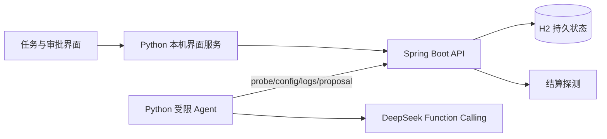
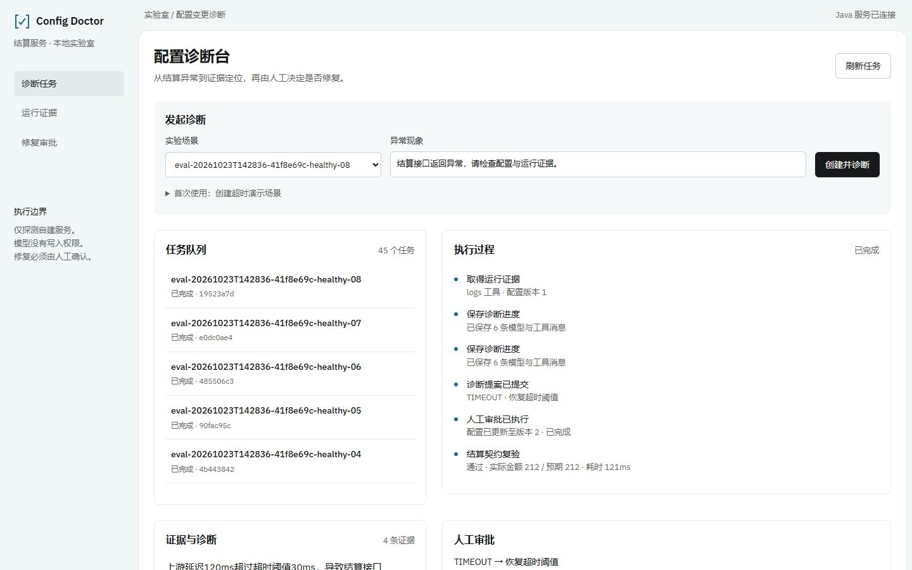

# Config Doctor 配置故障诊断实验室

为自建 Java 结算服务提供证据诊断、受限修复审批与复验。模型可选择查询配置、真实结算探测和请求日志，并提交带证据的诊断；它不能批准或执行配置修改。系统只监听本机，不连接公司或生产系统。

## 演示场景

上游调用耗时超过超时阈值，结算返回异常。用户创建诊断任务，Python Agent 调用真实工具获取现象、配置和日志，Java 保存证据与模型提案。人工核对字段级 before/after 补丁后批准，Java 校验配置版本、按白名单更新并对同一契约复验。重复审批不会二次修改，配置变化后旧提案拒绝执行。

实验室含超时、缓存价格不一致、容量阈值、税率和健康五族。金额异常的探测码统一为 AMOUNT_MISMATCH，模型必须结合配置区分原因；不从评测答案直接返回预制诊断。实验由确定性代码构造，不能视为生产事故或通用 AIOps 能力。

## 架构与职责



Java21、Spring Boot3.5、JDBC、H2负责事务、状态与权限；Python3.11+标准库负责模型适配、显式工具循环和评测；原生HTML/CSS/JS用于任务工作台。不引入消息队列或向量库，因为本场景没有相应需求。两进程属于职责划分，不作分布式生产平台宣传。

## 本地启动

选择 JDK21，安装 Maven3.9+ 与 Python3.11+。Python无第三方运行依赖。模型通过环境变量读取，仓库没有密钥。

```powershell
$env:JAVA_HOME='你的JDK21目录'
$env:PATH="$env:JAVA_HOME\bin;$env:PATH"
$env:DEEPSEEK_API_KEY='从自己的私密配置加载'
$env:DEEPSEEK_MODEL='deepseek-flash'
./start.ps1 -Build
```

打开 http://127.0.0.1:18081，在“首次使用”输入本机开发 operator-token，创建演示场景，再创建诊断。查看真实工具证据、根因与补丁，勾选确认后批准，检查复验结果。开发默认凭据仅供本机：viewer-token / worker-token / operator-token。可用 CONFIG_DOCTOR_VIEWER_TOKEN、CONFIG_DOCTOR_WORKER_TOKEN、CONFIG_DOCTOR_OPERATOR_TOKEN 覆盖；Java和Python要使用同一组值。不得直接将本机默认配置暴露到公网。

Linux/macOS可分终端运行：

```bash
mvn -f backend/pom.xml package
java -jar backend/target/config-doctor-backend-0.1.0-SNAPSHOT.jar
python -m agent.server
```

第二、第三条命令在仓库根执行，使用同一工作目录，以确保数据库位置可预测。数据默认写入 data/，可通过 CONFIG_DOCTOR_DB_URL 指定 H2 文件。启动失败先检查端口与 data/java.err.log。停止前备份 H2 文件，代码回滚用本地 Git 版本，不自动处理旧schema迁移。

运行后的任务、证据与审批界面如下，队列为自行创建的实验记录，不是生产用户数据。



## API与可靠性

GET /api/health 匿名健康检查。POST /api/cases 为operator创建实验场景；POST /api/tasks以幂等键创建任务；GET /api/tasks/{id}查看状态与证据。worker通过claim/checkpoint续租，调用tools/probe、tools/config、tools/logs，最终提交proposal。operator通过approve执行服务端白名单补丁。完整契约见交付目录04技术设计与 backend/api/ApiController.java。

数据库保存任务、消息、证据、审计事件与审批结果。运行租约防止两个worker同时推进，过期token不能继续写状态；审批绑定观察到的配置版本，事务提交补丁、复验与结果。只读工具崩溃窗口允许重复采集，写入动作靠数据库幂等约束。模型只拿固定工具schema，禁止任意URL、SQL和Shell；Java二次校验工具权限、枚举和证据归属。界面用textContent处理不可信内容，凭据不会进入LLM请求。

## 自动化测试与真实模型评测

```powershell
mvn -B -f backend/pom.xml test
python -m unittest discover -s agent/tests -v
python -m scripts.smoke
```

前两条不调用真实模型。第三条需要已启动Java和真实DEEPSEEK_API_KEY，创建一次超时场景，验证模型诊断、worker无审批权限、operator修复与幂等重放。大规模评测入口与实际统计见evaluation目录及交付05报告，不能用Mock测试通过率表示AI准确率。

评测集由公开实验配置与症状生成，必须记录版本、prompt哈希、实际模型ID、逐例轨迹、根因与动作正确性、证据、Token和耗时。参数变体不等于独立生产事故。仅在报告附原始结果时引用数字，不因接口可调用就声称效果达标。

实际2026-10-23结果：随机caseId的Agent批次20261023T144214-b1ce8584，五族40个合成变体根因/动作各40/40，32个故障由评测器审批后全部复验通过，中位诊断3070.5ms/2275Token。固定probe/config后单次模型同样40/40，中位1304.5ms/581Token；只看症状的无工具基线为28/40根因。当前没有证据证明多轮Agent优于固定取证，不能将本闭集结果外推生产。

完整摘要和原始轨迹见[评测批次登记](agent/evaluation/results/README.md)。早期带族名caseId的批次已因标签泄漏作废。引用ID有效只验证归属，不能证明解释逐句有据。以上耗时是在持久化修正前采集，不作最终配置压测结论。

真实恢复验收在checkpoint确认后立即终止Java，发现H2默认写延迟会丢最新messages。最终默认URL使用WRITE_DELAY=0，脚本也用该设置；修后强杀重启恢复6条messages与3条证据，旧token拒绝，新worker真实模型续跑并修复缓存价。运行`python -m scripts.test_restart`可复验，需真实模型Key；脚本在独立18082启动自己的JVM并停止，不触碰主服务。此验证不是断电或磁盘损坏测试。

## 当前限制

只有四种受限故障和一类健康场景，规则程序也能处理此闭集；不声称LLM比规则更优。没有真实分布式遥测、生产SSO/TLS、租户隔离、跨实例调度或线上SLA。H2是演示数据库，尚未验证PostgreSQL迁移。上下文恢复需要租约过期后重新运行worker；主动FAILED为终态，重新诊断应创建新任务。配置修复后若探测失败会如实记录FAILED，不伪造回滚成功。

## 贡献与后续

项目使用AI Coding协助实现；源码、实际测试与候选人个人掌握程度分别说明。后续有价值的工作是加入真实服务适配器、混合故障与分布外测试、更严格的证据支持判断及审计权限，而非扩充技术栈名称。当前没有远程发布或生产部署。
